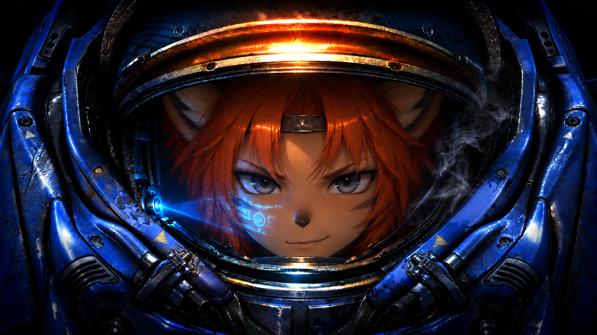

# PoroBotHQ

We build StarCraft II bots and tools to understand their decisions. Our current project is **porotoss**, a playful nod to Poroburu and Protoss. We aim to become an **[AI Arena](https://aiarena.net/) Division 1 bot team**, with Protoss as the flagship and functional Terran and Zerg bots as additional milestones.

Our stack uses **F# policies and .NET 10**. We compare modeled predictions with actual matches, keeping replays and traces to guide the next improvement.

## Projects

| Name | Purpose |
| --- | --- |
| [porotoss](https://github.com/PoroBotHQ/porotoss) | Project coordination, component selection and development guidance. |
| [porotoss-bot](https://github.com/PoroBotHQ/porotoss-bot) | Proprietary bot policies, game integration, private experiment adapters and native replay capture. |
| [porotoss-engine](https://github.com/PoroBotHQ/porotoss-engine) | Reusable factual SC2 contracts, optional native client and a basic starter. |
| [porotoss-platform](https://github.com/PoroBotHQ/porotoss-platform) | Infrastructure, shared development tooling and the currently selected workload execution modules. |
| [porotoss-workloads](https://github.com/PoroBotHQ/porotoss-workloads) | Standalone execution-framework preparation for running supported jobs and retaining their results. |
| [porotoss-planner](https://github.com/PoroBotHQ/porotoss-planner) | Standalone production models, constructor, simulator and advice library/CLI preparation. |
| [porotoss-train](https://github.com/PoroBotHQ/porotoss-train) | Shared experiment framework product; its first standalone preparation provides the typed contract library. |
| [porotoss-replays](https://github.com/PoroBotHQ/porotoss-replays) | Standalone shared replay domain, offline readers and processing/data-contract preparation. |

These development repositories are currently private; their links require collaborator access. The reusable engine has a separate public-release path.

The workloads, planner, train and replays repositories now have independent versions, builds and offline checks. Existing bot/platform consumers retain their original implementations while adoption proceeds. Generic experiment controller/core extraction remains pending, and native replay capture stays with the bot. Micro, macro and scripting are experiment extensions within the train product.

Shared typed models live in each producer's contract/model library: engine facts, workloads execution contracts, planner models, train experiment contracts and replay domain/data contracts. Collaborators can use the [product and term glossary](https://github.com/PoroBotHQ/porotoss/blob/main/docs/glossary.md) and [boundary map](https://github.com/PoroBotHQ/porotoss/blob/main/docs/repository-boundaries.md) to find the code names and current adoption state. The `porotoss-train` product name preserves existing `Porotoss.Experiments` code and serialized identities.

## What we want to understand

- **Economy:** resources collected, worker efficiency and production delays.
- **Combat:** resources lost through destroyed units, positioning, technology and upgrades.
- **Decisions:** what the bot intended, what it commanded and what happened.
- **The match over time:** traces, maps and visual analysis that reveal patterns.

Changes are reviewed in pull requests and tied to issues. Offline checks establish their scoped behavior; actual matches supply gameplay evidence. A completed loss is useful when it shows us what to improve.
